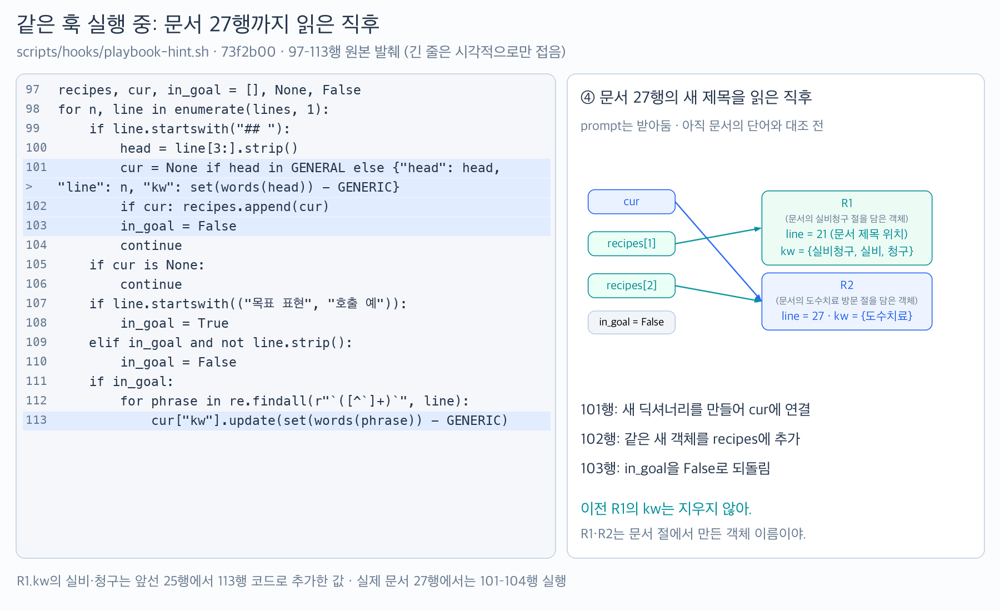
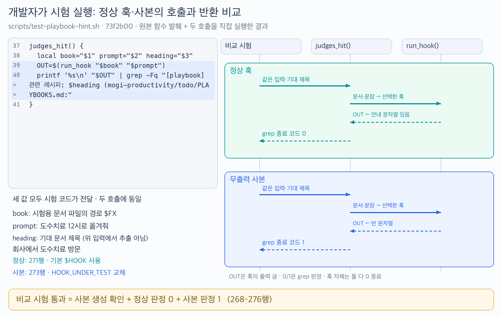

# todo-ops PR #8 — 문서를 따라 레시피 모으기와 같은 기준으로 고장 잡기

> [!note] 다음 세션에서 이어 읽기 — 2026-10-21
> 이 노트는 미완독이며 다음 세션에서 이어 읽기로 했다. 정확히 어느 코드 줄까지 독해했는지는 확인하지 않았으므로 완료 지점을 추정하지 않는다.
>
> 앞선 세션에서 모기는 내용은 괜찮지만 문장·표현에는 아쉬움을 밝혔고, 순서도·단계별 화면에 이어 Python Tutor 적용본도 원하던 형태가 아니라고 평가했다. 복잡한 코드에서 코드와 설명·그림을 나란히 보고 싶다는 요청은 있었으나, 당시에는 만족할 시각화의 구체 형식이 정해지지 않았다. Python Tutor를 기본 해법으로 재적용하지 않는다. 이후 제공된 캡처와 이번 적용은 바로 아래에 기록했다.
>
> [미채택 Python Tutor 실험](./archive/2026-10-21-pr8-python-tutor/reading-view.html)은 이력으로만 보관했다. [종료 기록](../../head-test/2026-10-21-todo-ops-pr8-hooks-and-code-visualization-session-end-analysis.md)에 질문·검증 범위·사용자 피드백을 남겼다. 원본 코드 판독 기준은 아래의 `73f2b00`이다.

> [!note] 시각화 적용 — 2026-10-21 후속 요청
> 모기가 웹 GPT에서 마음에 들었던 객체 참조 4컷과 정상·고장 사본 비교 그림을 캡처로 제공하고, 이 노트에 적용해달라고 요청했다. 아래 3·4절에 **본문에서 바로 보이는 PNG**를 넣었다. 모기는 PNG를 Markdown에 넣은 형식에 긍정적으로 반응했지만, 이후 실행 시점과 R1의 값이 어디서 왔는지 명시되지 않았다고 지적했다. 이번에는 문서 전체와 그림에 **입력 프롬프트 / 문서 내용 / 문서에서 만든 객체 / 훅의 출력 / 시험 판정**의 출처와 시점을 구분해 적었다. 수정 뒤 독해의 사용감은 아직 미관찰이다.

## 0. 판독 범위와 파일 지도

- 원본: [todo-ops PR #8](https://github.com/samkimpepper/todo-ops/pull/8). **mogi-productivity PR #8이 아니다.** 투두냥 운영 코드 학습을 기존 `mogi-productivity` 공책 분류에 보관한다.
- PR 코드 범위: `29142a97ebc573623858252e2458bebbe38bdb86..73f2b002aa5e47e746a3c9354c0037719d3d8d93`.
- 이번 수정 전후: `643bf98ef1ee6e35c28ac57296183c9468d8d85a..73f2b002aa5e47e746a3c9354c0037719d3d8d93`.
- 판독일: 2026-10-21. GitHub PR HEAD와 로컬 작업 폴더 HEAD가 `73f2b00`으로 일치한 시점이다.
- 최초 판독 checkout: `/Users/leechaerim/orca/workspaces/todo-ops/playbook-hint-hook`. 이 작업 폴더는 이후 없어졌고, 이번 문서 수정 때는 `/Users/leechaerim/orca/todo-ops`의 Git 이력에서 **같은 `73f2b00` 원문**을 읽었다. 제품·운영 checkout에는 쓰지 않았다.

PR 전체 변경 파일은 아래 **2개**, `+426/-0`이다. 이번 노트는 그중 두 독해 흐름만 펼친다.

| 변경 파일 | 역할 | 이 노트에서 읽는 부분 |
|---|---|---|
| `scripts/hooks/playbook-hint.sh` | 메시지와 레시피 문서를 읽어 관련 절의 위치를 출력하는 훅 | 문서 순회 `97–113`, 그 결과가 검색·출력으로 이어지는 연결 |
| `scripts/test-playbook-hint.sh` | 가짜 문서·실제 문서로 훅을 실행하고 결과를 검사 | 실행·판정 `31–48`, 가짜 문서 `59–104`, 고장 사본 비교 `266–278` |

PR에서 두 파일은 새 파일이다. 문서 순회 코드는 PR 전체 추가분이고, 판정 함수 분리는 마지막 수정 `643bf98..73f2b00`의 변경이다.

## 1. 모기의 메시지를 받은 운영 훅과, 개발자가 실행하는 시험

모기가 `도수치료 12시로 옮겨줘`라고 보낸 뒤, 그 메시지를 입력으로 받은 훅이 관련 작업 절차를 찾아 투두냥에게 읽을 위치를 안내하는 장면이다. **훅은 메시지 제출 같은 사건에 연결해 실행하는 스크립트**이고, 여기서는 `scripts/hooks/playbook-hint.sh`다. **레시피는 `PLAYBOOKS.md` 문서에 제목과 행동 절차로 적어둔 한 절**을 뜻한다.

운영에서 의도한 연결은 Claude Code(투두냥을 실행하는 에이전트 도구)의 메시지 제출 사건에 이 스크립트를 실행하도록 붙이는 것이다. 이 노트에서는 그 연결 자체의 동작을 확인한 것이 아니라, **스크립트가 메시지를 입력받은 뒤 수행하는 코드**를 읽고 시험했다. 훅의 역할은 관련 절을 읽으라는 안내 출력까지이며, 일정 변경은 이후 투두냥이 할 일이다.

### 이번 예시에서 각 글자는 어디서 왔나

| 화면·코드에서 볼 값 | 출처와 뜻 | 이번 실행에서 누가 사용하는가 |
|---|---|---|
| `도수치료 12시로 옮겨줘` | 이 노트에서 훅에 넣는 **입력 프롬프트**. 운영에서는 모기가 보내는 메시지에 해당하고, 시험에서는 테스트 코드가 이 문자열을 넣는다. | 훅이 `prompt`에 받아둠. 문서에서 단어를 모은 **뒤** 관련성 검색에 사용 |
| `## 실비청구` / `## 회사에서 도수치료 방문` | **문서 안의 두 제목**. 제목 앞의 `## `는 Markdown 제목 표기다. | 훅이 문서를 앞에서부터 읽으며 각 절의 레시피 객체를 만듦 |
| 문서의 `목표 표현:` 아래 문장 | 문서 작성자가 그 레시피를 찾을 표현의 예로 적어둔 글. 현재 입력 프롬프트와는 별개의 자료다. | 훅이 그 문장에서 검색 단어를 뽑아 해당 레시피 객체에 더함 |
| R1 / R2 | **그림에서만 붙인 객체 이름**. R1은 문서의 실비청구 절, R2는 방문 절에서 모은 값을 담은 딕셔너리다. 실제 코드에 `R1`·`R2` 변수는 없다. | 훅이 이번 실행의 Python 메모리에 만들며, 실행이 끝나면 다음 실행에 재사용하지 않음 |
| `[playbook] 관련 레시피: …` | 검색이 끝난 뒤 **훅이 출력하는 안내**. 입력 프롬프트나 문서 제목 자체와 구분한다. | 투두냥에게 읽을 문서 절을 알려주며, 시험에서는 이 출력 안에 기대 제목이 있는지 검사 |

**도수치료 메시지를 받아도 훅은 먼저 문서의 레시피들을 모은다.** 따라서 문서를 읽는 중에는 실비청구 객체도 만들어진다. 실비청구가 메시지와 관련 있는지 고르는 시점은 그 뒤다.

### 개발용 시험에서는 누가 메시지를 넣나

개발자가 `scripts/test-playbook-hint.sh`를 실행하면 시험 코드가 임시 문서를 만들고 위 메시지 문자열을 훅에 넣는다. 이어서 안내 출력 기능을 끈 사본에도 **같은 문장·같은 문서·같은 판정 기준**을 사용해, 검사가 출력 고장을 잡는지 확인한다. 운영 훅의 실행과 이 비교 시험은 서로 다른 실행이다.

> [!note] 모기 박스
> 힌트 키워드: 모기 메시지 / 문서에서 모을 것 / 테스트 실행 / 고장 발견
> 두 실행에서 누가 무엇을 확인하는지, 또는 아직 헷갈리는 점을 자유롭게 적어도 돼.
>
> 모기 메모:

## 2. 확인한 결과와 남은 범위

| 입력·조건 | 자동 시험 결과 | 실제 앱에서 확인할 범위 |
|---|---|---|
| 가짜 문서와 `도수치료 12시로 옮겨줘` | 방문 레시피 안내·문서 줄 번호 검사 통과 | 이 시험은 Claude Code를 거치지 않고 훅 스크립트를 직접 실행함 |
| 정상 훅과 출력 기능을 끈 사본에 같은 문서·문장·기대 제목 전달 | 정상 훅은 안내 판정 성공, 사본은 같은 판정 실패. 비교 검사 통과 | 개발용 시험이며 운영 세션에서 사본을 쓰지 않음 |
| `이 구간 테스트 추가해줘` | 안내 없음. `걷폰`·`석촌고분까지`·`퇴근길 폰`의 걷폰 안내는 유지 | 설정 연결 뒤 실제 메시지에도 안내가 전달되는지 |
| 대상 시험 파일 전체 | **과외냥이 직접 실행: 69개 검사 통과·실패 0·종료 코드 0** | 실제 세션에서 투두냥이 안내받은 절을 읽고 행동까지 챙기는지는 미확인 |
| 이번 그림의 상태·판정 값 | **추가 직접 확인:** `73f2b00`의 파서 구간을 실제 시험 문서의 21·23·25·27행까지 각각 실행. 같은 원본 `run_hook`·`judges_hit` 함수로 정상·무출력 사본을 실행해 `grep` 종료 코드 `0 / 1` 확인 | 그림의 값 대조를 위한 부분 실행. 전체 시험·실제 세션 실행의 재검증은 아님 |

위 69개 검사는 앞선 판독 때 `bash /Users/leechaerim/orca/workspaces/todo-ops/playbook-hint-hook/scripts/test-playbook-hint.sh`로 직접 실행한 결과다. 당시 실행 위치는 공책 폴더였고, 시험 스크립트는 임시 폴더를 만들고 종료 시 지웠다. 이번 문서 수정에서는 그림 생성기가 수행하는 부분 실행만 다시 확인했다. 운영 저장소 전체의 시험과 정책 위반을 시도하는 별도 검증은 재실행하지 않았다.

별도 [교차 리뷰](https://github.com/samkimpepper/todo-ops/pull/8#pullrequestreview-5595361107)는 판정 함수를 항상 성공하게 고쳤을 때도 비교 검사가 실패했다고 보고했다. 이는 리뷰어의 추가 실험이며 과외냥이 재실행 결과와 구분한다.

## 3. 모기의 메시지를 받은 훅: 검색 전에 문서에서 레시피 모으기

모기가 `도수치료 12시로 옮겨줘`라는 메시지를 보내 훅이 호출되면, 훅은 그 실행 안에서 먼저 `PLAYBOOKS.md`를 읽고 레시피별 제목·위치·검색 단어를 객체 목록에 모은다. 그런 다음 이 목록의 검색 단어를 모기의 메시지와 대조한다. 아래 그림은 **메시지를 받은 뒤, 대조를 시작하기 전에 훅이 문서를 읽는 구간**이다.

그림에서 실비청구 다음에 도수치료 방문이 나오는 이유는 **문서의 제목 순서**이기 때문이다. 네 컷 동안 받은 메시지는 `도수치료 12시로 옮겨줘`로 그대로이고, 달라지는 것은 **훅이 문서를 어디까지 읽었는지와 그때까지 모은 값**이다. 목록은 훅 실행마다 새로 만들며, 그 실행 동안만 메모리에 있다.

### 훅이 이번 실행에서 읽을 문서 내용 — 시험용 PLAYBOOKS.md

아래는 테스트 코드가 임시 `PLAYBOOKS.md` 파일에 써두는 내용의 일부다. 운영용 문서를 대신해 **이 시험에서 읽힐 입력 파일**이다. 여기 적힌 `실비청구`, `목표 표현`, backtick 안의 문장들은 모두 그 파일의 내용이다. 번호는 **그 임시 문서 안의 줄 번호**이며 코드 파일 줄 번호가 아니다.

```text
21  ## 실비청구
22
23  목표 표현:
24  - `실비청구해야 해`
25  - `실비 한꺼번에 청구할 거야`
26
27  ## 회사에서 도수치료 방문
28
29  목표 표현: `도수치료 예약했어`, `회사에서 병원 갈 거야`, `12시 반 도수치료`.
```

출처: `scripts/test-playbook-hint.sh:81–89`의 가짜 문서. `:60`의 `cat` 다음 줄이 문서 1행이다. 실제 제품 문서는 다른 내용·줄 번호를 가지며, 실제 문서의 도수치료 방문 제목은 이번 세션 판독 시 `131`행이었다.

훅은 줄을 읽으면서 세 값을 유지한다. 이 값들은 훅을 한 번 실행하는 동안만 Python 메모리에 있고 DB나 Things에 저장되지 않는다.

| 값 | 누가 무엇을 읽으며 유지하는 값인가 | 이번 훅 실행의 시작 값 |
|---|---|---|
| `recipes` | 훅이 **문서에서** 지금까지 모은 레시피 딕셔너리들의 목록 | 빈 목록 `[]` |
| `cur` | 훅이 **지금 읽고 있는 문서 절**의 레시피 딕셔너리를 가리킴. 모기가 현재 말한 주제를 뜻하지 않음 | 레시피 없음 `None` |
| `in_goal` | 훅이 **문서의 목표 표현·호출 예 구간**을 읽는 중인지 표시. 프롬프트에 키워드가 맞았는지 표시하는 값이 아님 | `False` |

여기서 딕셔너리는 Python에서 이름과 값을 묶는 자료구조다. R1에 저장되는 세 항목은 다음과 같다.

| R1 안의 항목 | 문서에서 가져오거나 계산한 값 | 뜻 |
|---|---|---|
| `head` | 문서 21행의 `## `를 뗀 `실비청구` | 문서 절의 제목 |
| `line` | `21` | 그 제목이 적힌 **문서 줄 번호**. 코드 21행을 뜻하지 않음 |
| `kw` | 처음에는 `{실비청구}`, 문서 25행까지 읽으면 `{실비청구, 실비, 청구}` | 문서 제목·목표 표현에서 뽑은 **이 레시피를 찾을 검색 단어 집합**. 프롬프트를 담는 칸이 아님 |

### 메시지와 대조하기 전, 훅이 문서를 읽는 네 시점

![실제 시험 문서의 21·23·25·27행 직후. cur와 recipes[1]이 R1을 함께 가리키고, R1.kw가 늘어난 뒤 다음 제목에서 cur와 recipes[2]가 R2를 가리키는 4컷](./assets/2026-10-21-pr8-visuals/parser-four-states.png)

**R1의 실비청구와 R2의 방문은 문서 제목에서 온 이름**이다. 그림의 객체는 각각 그 문서 절에서 모은 `head`·`line`·`kw`를 담고 있다. 실제 시험 문서는 실비청구보다 먼저 `NEXT-only 위젯`을 모으므로 실비청구는 `recipes[1]`, 다음 방문 레시피는 `recipes[2]`에 들어간다. Python 목록은 0부터 세므로 `[1]`은 두 번째 항목이다. `recipes[0]`의 NEXT 객체는 네 시점 모두 유지되며 그림에서만 생략했다.

④의 R2는 제목에서 막 만든 상태라 `kw={도수치료}`다. 제목의 `회사에서`는 `회사`로 줄인 뒤 제외하고, `방문`도 제외 단어라 넣지 않는다. 병원 등 목표 표현에서 얻을 단어는 **문서 29행을 읽을 때** 더해진다.

그림 값은 원본 파서 구간 `playbook-hint.sh:97–113`과 같은 파일의 단어 추출 정의를 실제로 실행해 확인했다. 외부 입력을 읽는 훅 전체의 중간 로그는 아니며, 원본 코드를 선택해 임시 시험 입력에 실행한 관찰이다. 집합의 표시 순서와 객체 이름·배치는 설명용이다.

### 훅이 문서의 제목 줄을 읽으면 현재 레시피를 바꾼다

실제 코드 발췌 — `scripts/hooks/playbook-hint.sh:97–106`, 판독 SHA `73f2b00`. 이 부분은 훅이 실행한 Python 프로그램의 본문이다. 같은 파일 92행에서 **문서 내용을 줄별로 나눈 목록 `lines`**를 만들었고, 아래 반복문은 그 문서 줄들을 순서대로 읽는다. 입력 프롬프트는 83행의 별도 변수 `prompt`에 받은 상태이며, 이 반복문에서는 아직 검색에 사용하지 않는다.

```python
recipes, cur, in_goal = [], None, False
for n, line in enumerate(lines, 1):
    if line.startswith("## "):
        head = line[3:].strip()
        cur = None if head in GENERAL else {"head": head, "line": n, "kw": set(words(head)) - GENERIC}
        if cur: recipes.append(cur)
        in_goal = False
        continue
    if cur is None:
        continue
```

- `enumerate(lines, 1)`은 문서의 첫 줄부터 `n=1, 2, …`를 붙여 읽는다. 이 번호가 나중 안내문의 `PLAYBOOKS.md:27` 같은 위치가 된다.
- 반복문의 `line`은 **지금 읽는 문서 한 줄의 문자열**이다. `line[3:]`은 그 줄의 제목 앞 `## ` 세 글자를 떼고, `strip()`은 양끝 공백을 없앤다. 객체 안의 `cur["line"]`은 이름은 같지만 **제목의 문서 줄 번호**를 담는다.
- `GENERAL`은 `목표에서 행동으로 펼치기` 같은 일반 설명 절 네 개의 제목 목록이다. 이를 만나면 `cur=None`으로 두어 그 절을 레시피로 모으지 않는다.
- `words(head)`는 같은 파일 `:68`의 함수다. 제목에서 검색 단어 후보를 뽑으며, `GENERIC`의 `회사`·`예약`·`구간`은 후보에서 뺀다.
- `continue`는 이번 줄의 나머지 코드를 건너뛰고 다음 문서 줄로 간다.

문서 21행의 제목을 읽으면, 코드 101행이 R1 딕셔너리를 만들고 `cur`가 그 객체를 가리키게 한다. 코드 102행의 `recipes.append(cur)`는 **R1의 복사본이 아니라 같은 객체의 참조**를 목록 두 번째 항목에 넣는다. 그래서 뒤에서 `cur["kw"]`를 수정하면 `recipes[1]`로 보아도 수정된 R1을 보게 된다. 문서 27행의 새 제목에서는 R2를 새로 만들어 `cur`가 R2를 가리키게 하며, `recipes[1]`은 R1을 계속 가리킨다.

### 훅이 문서의 목표 표현 구간을 읽으면 검색 단어를 더한다

바로 이어지는 실제 코드 — 같은 파일 `:107–113`. 앞의 `cur is None` 검사를 통과한 줄에만 실행된다.

여기서 `목표 표현`과 `호출 예`는 **문서에 적힌 구간 이름 두 가지**다. 훅은 문서 줄이 이 이름으로 시작하면 `in_goal=True`로 바꾸고, 그 구간의 예문에서 단어를 모은다.

```python
    if line.startswith(("목표 표현", "호출 예")):
        in_goal = True
    elif in_goal and not line.strip():
        in_goal = False
    if in_goal:
        for phrase in re.findall(r"`([^`]+)`", line):
            cur["kw"].update(set(words(phrase)) - GENERIC)
```

같은 파일 112행의 `re.findall(...)`은 **지금 읽는 문서 한 줄**에서 backtick으로 감싼 문구들을 뽑는다. 예를 들어 문서 24행에서는 문서에 적힌 `실비청구해야 해`를 꺼내 `phrase`에 넣는다. `words(phrase)`가 검색 단어를 만들면, 113행의 `update()`가 **R1의 `kw` 집합**에 단어를 더한다. 집합이므로 같은 단어를 다시 더해도 하나만 남는다. 이때 읽는 목표 표현은 문서의 예문이며, 입력 프롬프트를 새로 받은 것이 아니다.

### 같은 훅 실행에서 문서 27행을 읽은 직후 — 코드와 문서에서 만든 객체



파란 배경은 관계를 볼 코드의 위치 표시다. **모두 지금 실행 중이라는 뜻은 아니다.** 113행은 앞선 문서 25행에서 R1의 검색 단어를 늘릴 때 실행됐고, ④에서는 새 제목 분기의 101–104행을 실행해 R2를 만든다. 그림의 `>`는 긴 원본 줄이 화면에서 이어진다는 표시이며 코드 문자가 아니다.

아래는 위 코드와 실제 가짜 문서를 따라 적은 **설명용 중간 상태 추적**이다. 중간 변수를 로그로 따로 측정한 표는 아니다.

| 읽은 문서 줄 | `cur`가 가리키는 레시피 | `in_goal` 전후 | 무엇이 달라지나 |
|---|---|---|---|
| 21행 `## 실비청구` | 실비청구 딕셔너리를 새로 만듦 | 새 제목이므로 `False` | `recipes`에 추가. `kw`는 제목에서 뽑은 `실비청구` |
| 23행 `목표 표현:` | 실비청구 | `False → True` | 이후 문구를 이 레시피의 검색 단어로 받을 상태가 됨 |
| 24행 첫 목표 문장 | 실비청구 | `True → True` | `실비청구`를 더함. 이미 있으므로 중복되지 않음 |
| 25행 둘째 목표 문장 | 실비청구 | `True → True` | `실비`·`청구`가 더해짐. 이제 집합은 `실비청구`, `실비`, `청구` |
| 26행 빈 줄 | 실비청구 | `True → False` | 목표 표현 수집을 멈춤. 현재 레시피 자체는 유지 |
| 27행 다음 제목 | 도수치료 방문의 새 딕셔너리 | 새 제목이므로 `False` | 새 레시피를 목록에 추가. 실비청구는 앞서 모은 값으로 남음 |
| 29행 제목 뒤의 목표 표현 한 줄 | 도수치료 방문 | `False → True` | **같은 줄**의 세 backtick 문구도 즉시 수집 |

29행에서 `in_goal=True`로 바꾼 뒤 아래의 별도 `if in_goal`도 실행된다. 따라서 `목표 표현:`과 문구가 같은 줄에 있어도 문구를 놓치지 않는다.

### 문서를 다 읽은 뒤에야, 받아둔 프롬프트와 검색 단어를 대조한다

이 시점에 처음으로 두 출처가 만난다. **문서에서 모은 각 레시피의 `kw`**와 **입력으로 받아둔 `prompt`**를 대조하는 것은 같은 훅 파일 114–130행이다. 예시 메시지 `도수치료 12시로 옮겨줘`에 방문 레시피의 검색 단어 `도수치료`가 있는지 보고, 관련 후보들을 정렬한다. 132–136행은 고른 레시피의 문서 제목·문서 줄 번호로 안내를 만든다.

4컷은 이 대조 직전의 준비 과정만 보여준다. **R1이 목록에 만들어져 있다는 것과 R1이 검색 결과로 골라졌다는 것은 별개**다. 검색·정렬 전체 코드는 이번 집중 독해 범위 밖이다.

백엔드에서도 CSV의 현재 묶음, 로그의 현재 요청, 여러 줄 설정의 현재 절을 읽을 때 이런 상태 유지가 필요할 수 있다. 이 코드에서는 ‘현재 레시피’와 ‘목표 표현 수집 중’을 별도 값으로 둔 점을 보면 된다.

> [!note] 모기 박스
> 힌트 키워드: 현재 레시피 / 목표 표현 수집 / 빈 줄 / 같은 딕셔너리
> 한 줄을 읽었을 때 남는 값이나 Python 문법 중 궁금한 것을 자유롭게 적어도 돼.
>
> 모기 메모:

## 4. 개발자가 시험을 실행할 때: 정상 훅과 고장 사본을 같은 기준으로 검사하기

### 비교 시험이 같은 입력으로 정상 훅과 고장 사본을 각각 실행한다

개발자가 시험 스크립트를 실행하면, 시험 코드가 임시 문서를 만들고 `도수치료 12시로 옮겨줘`라는 **미리 정한 시험용 프롬프트**를 훅에 넣는다. 이때 모기가 직접 새 메시지를 보낼 필요는 없다. 정상 훅의 출력에는 `회사에서 도수치료 방문` 안내가 있어야 한다. 안내 출력 기능만 끈 임시 사본에도 같은 입력을 넣고, 그 안내가 없음을 확인한다.

| 코드 이름 | 누가 정한 값이며, 무엇을 가리키나 |
|---|---|
| `$T` | 시험 스크립트가 만든 임시 폴더의 경로 |
| `$FX` / 함수 인자 `book` | 시험 코드가 내용을 써둔 임시 `PLAYBOOKS.md` 파일의 경로. 문서 내용 자체와 구분 |
| 함수 인자 `prompt` | 시험 코드가 전달한 문자열 `도수치료 12시로 옮겨줘` |
| 함수 인자 `heading` | 시험 코드가 기대값으로 전달한 문서 제목 `회사에서 도수치료 방문`. 프롬프트에서 추출한 값이 아님 |
| `$HOOK` | 정상 훅 스크립트 파일의 경로 |
| `HOOK_UNDER_TEST` | 이번 호출에서 기본 `$HOOK` 대신 실행할 파일을 지정하는 변수. 사본 비교 때 `$T/mut.sh`를 지정 |

테스트 파일 `:267`의 `sed`는 문자열 치환 도구로, 정상 소스를 읽어 `$T/mut.sh`에 고장 사본을 쓴다. `:12`의 `$T`는 시험용 임시 폴더다. 이 작업은 원본 훅 파일을 수정하지 않는다. 출력하는 분기의 `printf` 앞에 `:`를 넣어 안내를 출력하지 않게 만든다. Bash의 `:`는 주어진 인자를 출력하지 않고 성공하는 명령이다.

같은 테스트 파일 31행의 `run_hook()`은 문서 경로와 프롬프트를 받아 훅을 실행한다. 39행의 `judges_hit()` 또는 다른 시험 코드가 이 함수를 호출한다. `run_hook(book, prompt)`는 인자 의미를 적은 설명용 표기이며, 실제 Bash 호출은 `run_hook "$book" "$prompt"`다. 함수 내부에서는 첫째 인자 `$1`을 `book`, 둘째 인자 `$2`를 `prompt`에 넣는다. 프롬프트를 `{"prompt": "도수치료 12시로 옮겨줘", …}` 형태의 JSON으로 만들고, 문서 경로는 환경 변수 `MOGUI_PLAYBOOKS_PATH`로 전달해 선택한 훅을 실행한다.

실행 경로를 고르는 실제 표현은 `:34`에 있다.

```bash
bash "${HOOK_UNDER_TEST:-$HOOK}"
```

이것은 긴 실행 줄의 **일부 발췌**다. `${A:-B}`는 `A`가 없거나 비었으면 `B`를 사용한다는 Bash 문법이다. 기본값 `$HOOK`은 원본 훅의 경로이며, 고장 비교 때는 `HOOK_UNDER_TEST`에 사본 경로를 준다.

### 실행 결과 수집과 안내 판정은 이렇게 연결된다

실제 코드 — `scripts/test-playbook-hint.sh:37–48`. `expect_hit()`은 정상 기능 시험 한 건에서, `judges_hit()`은 그 함수와 뒤의 고장 비교에서 호출된다.

```bash
judges_hit() {
  local book="$1" prompt="$2" heading="$3"
  OUT=$(run_hook "$book" "$prompt")
  printf '%s\n' "$OUT" | grep -Fq "[playbook] 관련 레시피: $heading (mogi-productivity/todo/PLAYBOOKS.md:"
}
expect_hit() {
  local book="$1" prompt="$2" heading="$3"
  if judges_hit "$book" "$prompt" "$heading"; then
    ok "'$prompt' -> $heading"
  else
    fail "'$prompt' expected $heading, got: ${OUT:-<nothing>}"
  fi
}
```

`judges_hit()`의 39행 `OUT=$(run_hook …)`는 훅을 실행해서 **출력된 글**을 `OUT`에 담는다. 이 변수에는 문서 전체나 입력 프롬프트를 넣는 것이 아니다. 40행의 `grep -Fq`는 그 출력 안에 **시험 코드가 기대한 제목과 경로 접두사**가 있는지 검사한다. `-F`는 정규식이 아니라 적힌 문자열로 비교하고, `-q`는 찾은 줄을 다시 출력하지 않는다는 뜻이다.

`judges_hit()`는 마지막 명령인 `grep`의 **종료 코드**를 호출자에게 돌려준다. 문자열을 찾으면 `0`이라 Bash의 `if`에서 성공이고, 못 찾으면 `1`이라 실패다. Python의 `True/False`를 출력해 전달하는 방식이 아니다. `OUT`은 실패 메시지에 실제 출력을 보여주기 위해 별도로 남는다.

`judges_hit()`은 ‘안내 전체가 정확히 일치하는가’를 검사하지 않는다. 시험 코드가 지정한 제목과 경로 접두사가 출력에 **포함되는지** 검사한다. 정확한 줄 번호·다른 안내 존재 여부는 별도 시험 항목이 맡는다.

### 어느 판정이 실패해야 전체 시험이 통과하는가

| 실행 대상 | 문서·문장·기대 제목 | `judges_hit()` 판정 | 이 비교 시험의 기대 |
|---|---|---|---|
| 원본 훅 | 가짜 문서 / 도수치료 12시로 옮겨줘 / 회사에서 도수치료 방문 | 성공 `0` | 정상 기능이 살아 있어야 함 |
| 무출력 사본 | 위와 정확히 같음 | 실패 `1` | 같은 검사가 출력 고장을 알아채야 함 |

여기서 ‘실패’의 주체를 구분해야 한다.

| 결과의 주인 | 정상 훅 실행 | 무출력 사본 실행 | 비교 시험이 기대하는 것 |
|---|---|---|---|
| 훅 프로그램 자체의 종료 코드 | `0` | `0` | 둘 다 실행을 마치지만, 이것만으로 안내의 존재를 알 수는 없음 |
| `judges_hit()` 안 `grep`의 종료 코드 | 안내가 있어 `0` | 안내가 없어 `1` | 같은 검사가 정상에는 성공하고 고장에는 실패해야 함 |
| 비교 시험 항목의 결과 | 위 두 실행을 함께 검사 | 위 두 실행을 함께 검사 | 사본이 만들어졌고 판정이 `0 / 1`이면 `ok` 기록 |
| 시험 파일 전체의 종료 코드 | 모든 시험 항목을 집계한 마지막 결과 | 모든 시험 항목을 집계한 마지막 결과 | 다른 항목도 모두 통과해야 전체가 `0`으로 종료 |

**사본의 안내 판정이 실패한 것**이 이 비교 시험에서 예상한 결과다. 사본의 판정까지 성공하면 검사가 고장을 놓친 것이므로 비교 항목은 `fail`을 기록한다.

### 개발용 비교 시험의 두 호출 — 받은 출력과 돌려준 판정



왼쪽은 원본 판정 함수이고, 오른쪽은 테스트 본문 271·273행의 두 호출을 펼친 그림이다. `run_hook()`이 선택한 훅을 실행하는 세부는 한 칸에 묶었고, **안내 출력이 `OUT`에 들어온 뒤 `grep`의 종료 코드가 비교 시험으로 돌아오는 관계**를 표시했다. 정상 훅·무출력 사본 자체의 종료 코드는 둘 다 `0`이며, 그림의 `0 / 1`은 **안내 포함 여부를 검사한 `grep`의 종료 코드**다.

그림의 판정 값은 `73f2b00` 원본의 `run_hook`·`judges_hit` 함수를 임시 훅 사본과 시험 문서에 직접 실행해 확인했다. 정상 출력에는 방문 레시피 안내가 있었고 사본의 `OUT`은 빈 문자열이었다. 시험 문서는 원본 비교 시점과 같이 뒤에 추가된 사료·서류 레시피까지 포함했다. 전체 시험 결과와 구분한 이 부분 실행의 기록은 아래 생성 근거에 있다.

그 조건을 연결한 실제 코드 — 같은 파일 `:268–276`.

```bash
if cmp -s "$HOOK" "$T/mut.sh"; then
  fail "failability: mutant not generated"
elif ! judges_hit "$FX" "도수치료 12시로 옮겨줘" "회사에서 도수치료 방문"; then
  fail "failability: real hook does not pass the hit judgement, got: ${OUT:-<nothing>}"
elif HOOK_UNDER_TEST="$T/mut.sh" judges_hit "$FX" "도수치료 12시로 옮겨줘" "회사에서 도수치료 방문"; then
  fail "failability: silenced mutant still passes the hit judgement: $OUT"
else
  ok "failability: hit judgement passes on the hook, fails on the silenced mutant"
fi
```

- `cmp -s`가 성공하면 원본과 사본 내용이 같다는 뜻이다. 의도한 치환이 안 됐으므로 실패를 기록한다.
- `! judges_hit ...`는 정상 훅의 판정이 실패했는지 본다. 정상 훅부터 실패하면 고장 비교의 기준이 없으므로 실패를 기록한다.
- `HOOK_UNDER_TEST=... judges_hit ...`는 그 함수 호출 동안 사본을 선택하게 한다. 같은 함수 내부의 `run_hook()`이 이 값을 읽는다. 이 줄의 판정이 성공하면 고장을 놓친 것이므로 실패를 기록한다.
- 모두 예상대로면 마지막 `else`에서 통과를 기록한다.

여기서 `fail()`은 Java 예외처럼 즉시 전체 실행을 끊지 않는다. `:17`에서 실패를 출력하고 집계 변수 `F=1`로 바꾼다. 마지막 `:278`이 `F`를 보고 전체 시험의 종료 코드를 `1`로 만든다. 따라서 **함수의 판정 실패**와 **시험 전체의 종료 실패**를 구분해야 한다.

백엔드 시험에서도 ‘정상 구현에 성공’만 보는 것과 ‘중요 동작을 없애면 같은 검사가 실패함’까지 보는 것은 다르다. 또한 프로그램을 교체하는 방법과 결과를 판단하는 기준을 나누면, 정상 구현과 고장 구현에 다른 잣대를 쓰는 실수를 줄일 수 있다.

> [!note] 모기 박스
> 힌트 키워드: 같은 입력 / 실행 경로 교체 / 판정 종료 코드 / 시험 전체 결과
> 두 종류의 실패나 함수 호출 흐름에서 이해한 점·남은 질문을 자유롭게 적어도 돼.
>
> 모기 메모:

## 5. 다시 볼 때 붙잡을 두 줄

문서 순회: **메시지를 입력받은 훅**이 같은 실행 안에서 **문서의 제목·목표 표현**으로 레시피 객체들을 만든다. R1은 문서의 실비청구 절을 담은 객체이며, 입력 프롬프트가 아니다. 모은 검색 단어와 받아둔 프롬프트를 대조하는 것은 문서를 읽은 뒤다.

시험 비교: **개발자가 실행한 시험 코드**가 같은 문서 경로·프롬프트·기대 제목으로 정상 훅과 무출력 사본을 각각 실행한다. 정상의 안내 포함 판정은 `0`, 사본은 `1`이어야 고장을 잡는 비교 항목이 통과한다.

구현 연결은 다음과 같다.

```text
운영: 메시지를 받은 훅 실행 → 문서 읽기 → recipes / cur / in_goal 갱신 → 받아둔 메시지와 단어 대조 → 관련 절 안내
시험: expect_hit → judges_hit → run_hook → 원본 훅 실행 → 안내 포함 여부 판정
비교: judges_hit → run_hook → 원본 / 사본 교체 실행 → 같은 판정의 성공 / 실패 비교
```

> [!note] 모기 박스
> 힌트 키워드: 문서 읽기 / 현재 상태 / 같은 판정 / 다음 질문
> 나중에 다시 보고 싶은 코드나 질문을 자유롭게 남겨도 돼.
>
> 모기 메모:

## 6. 이번에 펼친 코드와 남은 범위

두 변경 파일 모두 핵심 발췌를 읽었다. `playbook-hint.sh`는 문서 순회와 역할 연결을, `test-playbook-hint.sh`는 공통 판정·가짜 문서·고장 사본 비교를 펼쳤다. 고장 사본 비교는 `643bf98..73f2b00` 실제 diff와도 대조했다.

문서 읽기 제한·로그 기록·후보 점수와 정렬 전체·전체 시험 파일의 모든 검사를 이 노트에서 설명하지는 않았다. `.claude/settings.json` 연결과 `todo-scoped-hook.py`는 이 PR의 변경 파일이 아니며, 이 노트의 집중 독해 범위 밖이다.

### 모기의 요청 원문

> 흠 주니어백엔드개발자로서 코드 봐야할곳있으면 소개해주셈
>
> 오오 두번째랑 세번째 code-diff note 만들어가지고 보자옹

이 노트는 두 번째 추천인 문서 순회와 세 번째 추천인 정상·고장 사본 비교를 남긴다. 첫 번째 추천인 입력 크기의 `+ 1` 검사는 채팅에서 설명했으며 여기서 반복하지 않는다.

### 그림의 생성 근거 — 필요할 때만

그림은 기존 노트의 읽기 자료다. PNG를 보기 위해 별도 HTML이나 웹서비스를 열 필요는 없다. 객체 참조의 배치는 Graphviz로 만들고, 코드·4컷·호출 비교 화면은 Pillow로 합성했다.

PNG 3개의 글자·화살표·잘림 여부와 상대 경로는 직접 확인했고, Orca에서 이 Markdown 탭을 여는 명령도 성공했다. 다만 macOS 접근성 권한으로 Orca 화면 판독이 차단되어 **Orca 미리보기 안의 실제 인라인 표시는 아직 미확인**이다.

- [그림 생성 코드](./assets/2026-10-21-pr8-visuals/build_visuals.py): 판독 SHA의 Git 원문에서 필요한 구간을 읽고, 부분 실행·값 대조·이미지 생성을 수행한다. 제품 checkout에는 쓰지 않는다.
- [부분 실행 관찰값](./assets/2026-10-21-pr8-visuals/observations.json): 네 시점의 값, `cur`와 목록 항목의 객체 동일성, 정상·사본의 실제 출력·판정 종료 코드를 기록했다.
- [파서 원본 발췌](./assets/2026-10-21-pr8-visuals/parser-original.txt), [실행·판정 원본 발췌](./assets/2026-10-21-pr8-visuals/judgement-original.txt), [비교 원본 발췌](./assets/2026-10-21-pr8-visuals/comparison-original.txt). 코드 이미지의 긴 줄은 시각적으로만 접었다.
- 참조 그림 원본: [①](./assets/2026-10-21-pr8-visuals/refs-1.dot) · [②](./assets/2026-10-21-pr8-visuals/refs-2.dot) · [③](./assets/2026-10-21-pr8-visuals/refs-3.dot) · [④](./assets/2026-10-21-pr8-visuals/refs-4.dot).
